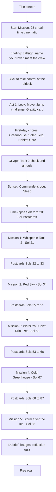

# SOL COMMANDER — Story Bible, Master Timeline & Voice Script (v2)

> **For the AI implementer (AI Studio, Cursor, Antigravity) and the two humans.**
> Audience: kids aged 7–9. **All player-facing text and speech is English only.** This document replaces the current story order, the current voice lines, and the current mission trigger flow. It keeps the five missions, the Critical Sols (21, 34, 52, 67, 88), the four resources, the 4-crew team, Rusty, the quizzes, the Science Cards and the badges that already exist in the build.
> Hard constraints still apply: no NASA/JPL logos, flags or patches; no AI-generated images or video; every number tagged [REAL], [DERIVED] or [SIM]; every value shown as "simulation value" when it is [SIM].

---

## 0. What is wrong today, and the fix

| # | Problem in the current timeline | Fix in this document |
|---|---|---|
| D1 | The six tutorial steps are followed **immediately** by a gas-tank emergency. No time to care about the base or the crew, so there is no story and no thrill. | Add **Act 1 "Settling In"**: first-day chores with each crew member, small warning signs (foreshadowing), a sunset log entry, then a **time-lapse of Sols 2–20** with "Sol Postcards". |
| D2 | **Voices jump around**: Rafi shouts an alarm, then the rover says "go, go, fast". Nobody knows who is talking or why. | A **Speaker Ladder** (section 2): the base computer gives a calm notice, then the crew member who owns that system calls the Commander, then Rusty comforts and teaches. **Rusty never rushes the player.** |
| D3 | Emergencies are **not realistic** ("fracture", "deadly radiation in 60 seconds"). | Every problem follows **cause → quiet sign → notice → investigation → decision** (section 7). Real warning times and calm wording. |
| D4 | Voice lines contain **units, symbols and hard words** that cannot be pronounced. | Each line has a `text` (screen) and a `speech` (voice) field. Normalisation table and word swaps in section 3. |
| D5 | The "Can we breathe Mars air?" quiz appears twice; the Mission 1 quiz repeats the tutorial. | New Mission 1 quiz about valves. |
| D6 | Mission 1 is a crisis with no mystery. | Mission 1 becomes **"Whisper in Tank 2"**: the player *hears* the leak and follows the sound. |
| D7 | Tutorial is a six-step lecture. | Four short control steps, then learning through chores. |
| D8 | Wording risks: "**NASA Junior Mars Commander certificate**", "**Starship**" in the prologue, a 100-point score card in Junior mode. | Rename to **"Junior Mars Commander — in-game badge"** (never "NASA certificate"); call the ship **"the lander"**; show scores only in the Grown-up summary. |
| D9 | Hard weather words (katabatic gusts, electrostatic squall). | Keep **dust devils** and **dust storms** only. |
| D10 | No cliffhangers between missions. | Each mission ends with a **hook** that opens the next problem. |

---

## 1. The story in one page

**Logline:** *Five people, one friendly rover, 88 days on Mars, and no rescue ship. Every problem has a reason, and every choice has a price.*

**Theme:** *Look. Listen. Think. Then decide.*

**Tone:** warm, curious, a little suspenseful. Never graphic, never scary. Danger is real but the crew always has a chance if the Commander thinks.

**Arc:**
1. **Arrive** and fall in love with the base and the crew.
2. **Small signs** appear (a tiny hiss, a yellow sky, a noisy pump).
3. **Five problems** hit, one after another. Each is caused by something the player already saw.
4. **The final storm** tests everything. The rover and the geologist are outside; the Commander must bring everyone home.

### Cast

| Character | Role | Voice style | Signature | Station |
|---|---|---|---|---|
| **Commander Nova** | The player. Never speaks aloud. Writes the **Commander's Log** (text). | — | — | Everywhere |
| **{roverName} (default Rusty)** | The child's rover friend and teacher | Curious, brave, a little funny; short sentences; a soft beep after each message | "Let's look together." | Follows the player |
| **Hab Computer** | The base system | Calm, neutral | "Notice." "Watch." "Warning." | Whole base |
| **Dr. Amara Nwosu** | Flight Surgeon | Gentle, kind | "Deep breath, Commander." | Habitat core, water bay |
| **Kenji** | Chief Engineer | Relaxed, jokes about tape and bolts | "Everything can be fixed." | Solar field, tanks |
| **Lucía Ferreira** | Lead Geologist | Excited, loves rocks | "Look at this one!" | Rover bay, ice site |
| **Rafi Chowdhury** | Botanist and Life Support | Warm, soft-spoken, loves tomatoes | "Plants are friends." | Greenhouse, oxygen bay |
| **Earth Team** | Mission Control | **Text messages only**, delayed (4 to 24 minutes one way) | "Message from Earth" | — |

**Rusty's personal arc:** Rusty wants to be useful (Mission 2: offers to clean the panels), wants to see ice (Mission 3: scans for it), and is **outside in the storm** with Lucía in Mission 5. The child feels responsible for a friend.

> **Open item (humans decide):** the engine counts resources for **four** people, but the build has the Commander **plus four crew**. Either set the crew count to five in `constants.ts` (and say so in the Grown-up notes), or treat the Commander as part of the four and remove one NPC. Mark any change [SIM].

---

## 2. Who speaks, when, and how (the Speaker Ladder)

**Rule 1 — One voice at a time.** A new line waits until the current line ends (queue, max one line waiting).
**Rule 2 — Same order every time:**

| Step | Speaker | Style | Example |
|---|---|---|---|
| 1 | **Hab Computer** | Calm notice (amber chime). Escalates only if needed. | "Notice. Oxygen Tank two pressure is a little low." |
| 2 | **The crew member who owns that system**, by radio | Calm, asks for help, never shouts | "Commander, Rafi here. Can you meet me at the oxygen bay?" |
| 3 | **Rusty** | Companion and teacher; asks questions | "Let's listen together." |

**Rule 3 — Alert levels (no constant red).**

| Level | Colour and sound | When |
|---|---|---|
| **Notice** | Amber, soft chime | First sign of a problem |
| **Watch** | Amber, double chime | The problem is growing |
| **Warning** | Red (calm pulse, no strobe), low tone | Only at the final climax (Mission 5) or if the player ignores a problem for a long time |

**Rule 4 — Rusty never rushes.** Banned Rusty words: "hurry", "rush", "quick quick", "go go", "fast fast". Rusty may say "I am coming!" about himself.

**Rule 5 — Line budget.** Max **2 short sentences per line** and **3 lines per event**. Max 12 words per sentence. One idea per line.

**Rule 6 — Every voice has a source.** Radio lines show a **radio icon and the speaker's stylised portrait** (no real faces). In-person lines come from the character's 3D position. A crew member may only speak by radio if they are **not** near the player.

**Rule 7 — When Rusty speaks** (triggers only, from the design doc): start of a Sol, an event arrives, a resource crosses its warning level, a mission ends, or the player asks for a hint. Otherwise Rusty is quiet. A **Quiet Rover** button stops Rusty's chatter (alerts still show as icons).

**Rule 8 — No repeats.** Keep **3 variants** for each repeating trigger and never play the same variant twice in a row.

| Trigger | Rusty variant 1 | Variant 2 | Variant 3 |
|---|---|---|---|
| Sol starts | "Good morning, Commander. Beep!" | "A new Sol begins. Let's look together." | "The Sun is up. What shall we check?" |
| Right answer | "Yes! You got it." | "Correct! Great thinking." | "That's right, Commander!" |
| Wrong answer | "Not quite. Let's look again." | "Try again. I will wait." | "Hmm, look closely. What do you see?" |
| Mission done | "We did it, Commander!" | "The crew is safe. Well done." | "Beep! That was good teamwork." |

### Voice policy (read before adding any voice)

- **On-screen text is always the source of truth.** Subtitles are always on.
- Space Apps rules require any **AI or synthesised voice** to be disclosed in the "Use of AI" field, in `AI_USE.md`, and on the About screen. If you add a speech-synthesis voice, put it behind a **Voice On/Off toggle**, list it in those places, and never use a cloned or celebrity voice.
- Rusty's "voice" can be beeps plus subtitles (no disclosure issue). This is the safest choice.
- Give each speaker a different beep or chime so players know who is talking even without voice.

---

## 3. Speech-ready text (so voices can say every line)

Every spoken line has two fields: `text` (what the screen shows) and `speech` (what the voice says). `speech` must pass the normaliser and the lint check below.

### 3.1 Conversion table

| Written | Spoken |
|---|---|
| m/s² or m/s2 | meters per second squared |
| m/s | meters per second |
| km/h | kilometers per hour |
| kg/sol | kilograms per sol |
| kg | kilograms |
| kPa / Pa / mb | kilopascals / pascals / millibars |
| mSv | millisieverts |
| Wh / kWh | watt hours / kilowatt hours |
| −63 °C | minus sixty-three degrees |
| °C | degrees Celsius |
| % | percent |
| × | times |
| ~ or ≈ | about |
| CO2 / O2 / H2O | carbon dioxide / oxygen / water |
| Sol 21 / Tank 2 | Sol twenty-one / Tank two |
| 2–6 | two to six |
| 24 h 39 min | twenty-four hours and thirty-nine minutes |
| 3:00 (timer) | three minutes |
| NASA | N A S A (say the letters) |
| DONKI | the space weather team |
| CME | solar storm |
| any `[REAL]`, `[SIM]`, `[DERIVED]` or other bracket tag, emoji, arrows, slashes used as symbols | **removed completely**; the voice says only the main sentence |

### 3.2 Easy-word swaps

| Do not say | Say instead |
|---|---|
| isolation valve | shut-off valve |
| fracture, vent | crack, leak |
| cryogenic | very cold |
| perchlorates | salty chemicals |
| sub-surface | under the ground |
| photovoltaic | solar |
| distillation, reclamation | cleaning |
| proton radiation | space radiation |
| coronal mass ejection | solar storm |
| magnetic field | magnetic shield (like Earth has) |
| hydrogen wall | water wall |
| atmosphere | air |
| EVA | outside walk |
| telemetry | numbers |
| regolith | Mars dust and soil |
| katabatic, electrostatic squall | (delete) |
| ISRU, RTG, UI | (delete) |

### 3.3 Implementation

- `normalizeForSpeech(text)` applies 3.1 and 3.2 automatically; authors may also write `speech` by hand.
- **Lint check (build fails if it matches any `speech` string):** `/[\d]|[\[\]²%°×≈~→/]|m\/s|kg|kPa|mSv/`
  (digits must be spelled as words in `speech`).
- A unit test loads every beat in `storyBeats.ts` and runs the lint check.

---

## 4. Master timeline (A to Z)

Target first-play length: **about 33 minutes**. Times are pacing targets. Resources never drain while the player is reading, thinking or walking slowly: they change only when an event or a Sol advances.



| Scene | Time | Trigger to start | Player does | Speaker | Gate to next |
|---|---|---|---|---|---|
| **S0.1 Title** | 0:00 | Game loads | Click Start Mission | — | Click |
| **S0.2 Cinematic** | 0:00–0:30 | Start Mission | Watch (skippable) | Captions + Rusty beeps | End or skip |
| **S0.3 Briefing** | 0:30–1:15 | Cinematic ends | Choose callsign, name the rover, see crew cards | Text | Click Begin |
| **S0.4 Take control** | 1:15 | Briefing ends | Click to lock the mouse | — | Click |
| **S1.1 Look** | 1:15–1:45 | Control given | Turn the view 60° | Rusty | Turn done |
| **S1.2 Move** | 1:45–2:30 | Look done | Walk to the yellow light (7 m) | Rusty | Reached |
| **S1.3 Jump challenge** | 2:30–3:45 | Move done | Jump to collect 3 crystals | Rusty | 3 of 3 |
| **S1.4 Gravity card** | 3:45–4:15 | 3 of 3 | Read card (Continue or Skip) | Rusty | Continue |
| **S1.5 First-day chores** | 4:15–6:00 | Card closed | Visit Greenhouse, Solar Field, Habitat Core; press E | Rafi, Kenji, Amara, Lucía | 3 of 3 visited |
| **S1.6 Oxygen check** | 6:00–6:45 | Chores done | Inspect Tank 2; answer air quiz | Rusty, Kenji | Quiz right or skipped |
| **S1.7 Sunset log and sleep** | 6:45–7:15 | Quiz done | Read log; press Sleep | Text | Sleep |
| **S1.8 Time-lapse Sols 2–20** | 7:15–7:45 | Sleep | Watch 4 postcards | Text | Auto |
| **M1** | 7:45–12:15 | Sol 21 begins | See section 5.1 | Hab, Rafi, Rusty | Badge |
| **Postcards 22–33** | 12:15–12:40 | M1 done | Watch (free-roam window of 90 s first) | Text | Auto |
| **M2** | 12:40–17:10 | Sol 34 | Section 5.2 | Hab, Kenji, Rusty | Badge |
| **Postcards 35–51** | 17:10–17:35 | M2 done | Same | Text | Auto |
| **M3** | 17:35–22:05 | Sol 52 | Section 5.3 | Hab, Amara, Lucía, Rusty | Badge |
| **Postcards 53–66** | 22:05–22:30 | M3 done | Same | Text | Auto |
| **M4** | 22:30–27:00 | Sol 67 | Section 5.4 | Hab, Rafi, Rusty | Badge |
| **Postcards 68–87** | 27:00–27:25 | M4 done | Same | Text | Auto |
| **M5** | 27:25–32:55 | Sol 88 | Section 5.5 | Hab, Amara, Lucía, Rusty | Badge |
| **Debrief** | 32:55–36:00 | M5 done | Recap, badges, reflection quiz | Rusty | Finish |
| **Free roam** | Optional | After debrief | Explore freely | Crew and stations | — |

---

## 5. Scripts

Format: **Speaker** — `On-screen text` — *Speech (only where different)*

### 5.0 Act 0: Launch

**S0.1 Title screen.** Tagline: "88 days on Mars. Your crew needs you, Commander." Background: the compact hero outpost with Mars wind.

**S0.2 Cinematic (28 s, real-time, replaces the video).** Captions (see the UX prompt for the shot list): "MARS OUTPOST · SOL 1" → "HABITAT — your home on Mars" → "GREENHOUSE — fresh food and air" → "OXYGEN TANK 2 — keep it safe" → "{roverName} — your rover friend" → "SOLAR ARRAY — power for the base" → "You are Commander Nova". Rusty beeps once per shot. Do not mention any real rocket or company; if a landing is shown, call it "the lander".

**S0.3 Briefing.**
- Pick a callsign (for example Commander Nova, Ares Vanguard).
- **Name your rover** (default Rusty, 12 letters max, session only).
- Crew cards (each one line):
  - Amara — "Keeps everyone healthy."
  - Kenji — "Fixes anything."
  - Lucía — "Finds Mars secrets in rocks."
  - Rafi — "Grows food and watches the air."
- **Message from Earth** (text, "sent 12 minutes ago"): "Welcome to Mars, Commander. Take care of each other. We believe in you."

### 5.1 Act 1: Settling In (S1.1 to S1.8)

**S1.1 Look.** Rusty — `Beep! Hello, Commander. I am {roverName}. Move the mouse to look around.`
**S1.2 Move.** Rusty — `Walk to the yellow light. Mars is bouncy, so take it easy.`
**S1.3 Jump challenge.** Rusty — `Try a jump! Press Space. Catch three glowing crystals.`
After each crystal: `One!` · `Two!` · `Three! Wow, look how high you went!`
**S1.4 Gravity card.** Title: Mars Gravity. Text: "Mars pulls you down less than Earth does. You can jump higher here!" *Speech: "Mars pulls you down with less than half of Earth's pull."*

**S1.5 First-day chores.** Rusty — `Let's say hello to the crew. Walk up and press E.`

| Place | Speaker | Text (foreshadowing in bold, do not mark it on screen) |
|---|---|---|
| **Greenhouse** | Rafi (in person) | "Welcome to my garden! These tomato seeds are my babies. **They need light, water and warmth. I hope the nights stay kind.**" |
| **Solar Field** | Kenji (in person) | "These panels turn sunlight into power. Mars is dim, so every panel counts. **Keep them clean and they keep us cozy.**" |
| **Habitat Core** | Amara (in person) | "Welcome, Commander. Drink some water. Mars air is very dry." |
| **Habitat Core** | Lucía (in person) | "Look at this rock! It has stripes. **Water may have been here long ago.**" |

When all three places are visited, Rusty — `Great work! One last check. Let's see the oxygen tank.`

**S1.6 Oxygen check.** At Tank 2:
- Rusty — `This is Tank two. It holds our air.`
- Ambience: a very quiet **tick-hiss** (foreshadowing). Rusty — `Hmm. Did you hear a tiny tick? Maybe it is nothing.`
- **Quiz** — Rusty — `Quick question. Can we breathe the air on Mars?` (A. Yes, like Earth · **B. No, we need oxygen**)
  - Right: `That's right! Mars air is not safe to breathe. We bring our own air.`
  - Wrong: `Not quite. Let's look at the tank again.` (retry, unlimited; Skip appears after two tries)
- Science Cards unlock: *Mars Air* and *A Mars Day*.
- Kenji (radio) — `Commander, Kenji. The Tank 2 gauge wiggled today. I will check it again next week.`

**S1.7 Sunset log and sleep.** Rusty — `This is our home. Everyone is safe inside.` (Habitat map peek.)
Commander's Log (text): "Sol 1. We are home. The crew is great. Tank 2 made a funny little noise." → **Sleep** button.

**S1.8 Time-lapse, Sols 2–20 (four Sol Postcards, 4 seconds each, skippable).**

| Sol | Postcard |
|---|---|
| 3 | "Lucía finds striped rocks near the crater." |
| 8 | "Rafi's first tomato seed pops up!" |
| 12 | "Message from Earth: The sky looks calm for now. (Sent 12 minutes ago.)" |
| 17 | "Kenji checks Tank 2 again. It is a little lower than Tank 1." |

### 5.2 Mission 1 — "Whisper in Tank 2" (Sol 21)

**Cause (real-life reason):** Mars nights are very cold and days are warmer. Metal parts shrink and grow every day, and a valve seal got loose.

| Beat | What happens | Lines |
|---|---|---|
| **M1.1 Quiet signal** (0:00) | Sunrise in the habitat. Amber chime. | Hab Computer — `Notice. Oxygen Tank 2 pressure is a little low.` *Speech: "Notice. Oxygen Tank two pressure is a little low."* Rafi (radio) — `Commander, Rafi here. Tank 2 is dropping slowly. Can you meet me at the oxygen bay?` Rusty — `I will come with you. Beep!` |
| **M1.2 Look** (0:45) | Player walks to the bay (about 15 m). Gauge needle drifts down. | Rafi (in person) — `See the needle? It moves down, little by little.` Rusty — `Let's listen together.` |
| **M1.3 Pipe Detective** (1:30) | The player **hears a faint hiss** (3D sound). Three pipes: inspect each with E. Pipe 2 has a blinking amber light and a small white puff. | Rafi — `Do you hear that whisper? Follow the sound.` Rusty — `Found it! Valve two is loose.` |
| **M1.4 Quiz** (2:30) | Rusty's quick check | `How can a valve help with a leak?` (**A. It can close one part of the pipe** · B. It makes the tank bigger). Right: `Yes! A valve can close off the leaky part.` Wrong: `Try again. What does a valve do to a pipe?` |
| **M1.5 Decision** (3:00) | Command Mode, world paused | Rafi — `What is your plan, Commander?` |
| **M1.6 Action** (3:30) | A: hold E to close Valve 2. B: crew walk to the backup room. | — |
| **M1.7 Result** (4:00) | See below | |
| **M1.8 Card, badge, hook** (4:20) | Science Card, Oxygen Guardian badge | See below |

**Decision card (no free option):**
- **A. Close Valve 2.** Stops the leak. Uses a little power and one spare part. Tank 2 stays shut for a while.
- **B. Move the crew to the backup room.** Everyone is safe now. But air keeps leaking.
- *More choices* drawer: the other engine options (kept from the current build).

**Result lines:**
- A — Rafi: `The whisper stopped. Good job, Commander.`
- B — Rafi: `We are safe. But the tank is still losing air. We will fix it soon.`

**Science Card (kid copy):** "A shut-off valve can close one part of a pipe. This helps stop a leak." *Grown-up note:* the leak rate used is a simulation value.

**Hook:** Kenji — `I think I know why. Mars nights are very cold. Metal shrinks in the cold and grows in the day. The seal got loose.` Then Rusty — `Beep. Commander, did the sky look different today?` (the sky is a little yellow).

### 5.3 Mission 2 — "Red Sky" (Sol 34)

**Postcards, Sols 22–33:** Sol 24 "The sky looks a little yellow." · Sol 28 "The panels make less power than last week." · Sol 31 "Message from Earth: Dust is spreading across the plains. (Sent 14 minutes ago.)"

| Beat | What happens | Lines |
|---|---|---|
| **M2.1 Quiet signal** | Sky orange-grey; the Sun looks small. | Hab Computer — `Notice. Solar power is lower than normal.` Kenji (radio) — `Commander, Kenji. The sky is full of dust. The panels make less power. Meet me at the solar field.` |
| **M2.2 Walk** | Player walks about 33 m (the sky changes on the way). | Rusty — `The Sun looks small and orange today.` |
| **M2.3 Look** | Kenji at the power meter. | Kenji — `See the power meter? It is going down.` |
| **M2.4 Activity** | **Sunlight Slider** | Rusty — `Move the slider. See what dust does to the light.` |
| **M2.5 Quiz** | | `What do solar panels use to make electricity?` (**A. Sunlight** · B. Moonlight). Right: `Yes! Sunlight!` Wrong: `Try again. Look at the bright Sun above the panels.` |
| **M2.6 Rusty's offer** | Emotional beat before the decision | Rusty — `I can go out and clean the panels! Beep. But the wind is wild.` Kenji — `Dust storms last many days. Let's wait for the sky to clear.` |
| **M2.7 Decision** | | See below |
| **M2.8 Result, card, badge** | | See below |

**Decision card:**
- **A. Keep important systems ON and turn off extra machines.** The battery lasts longer. Greenhouse and science work may slow down.
- **B. Keep every machine running.** All work continues. The battery may run out fast.
- *More choices:* **"Send {roverName} to clean now"** (risky; uses the engine's existing storm-stuck chance, a simulation value). If chosen, Rusty — `I am brave! Beep.` If Rusty gets stuck: `Oh no, my wheels are stuck! Please wait for me.` If the player waits instead, Rusty — `Thank you for keeping me safe. I will polish the panels after the storm.`

**Result lines:** A — Kenji: `Smart plan. Power for life support comes first.` B — Kenji: `Everything is on, but the battery is dropping fast.`

**Science Card:** "Dust in the air blocks some sunlight. Solar panels make less power when less light reaches them." *Grown-up note:* the Opportunity rover's solar output fell as dust got thicker (historical, archived data; show the ARCHIVED label).

**Hook:** Amara (radio) — `Commander, the water recycler is making a funny noise. Please check it when you can.`

### 5.4 Mission 3 — "Water You Can't Drink Yet" (Sol 52)

**Postcards, Sols 35–51:** Sol 38 "Lucía's radar finds a pocket of ice near the crater." · Sol 44 "The recycler works hard. Everyone drinks clean water." · Sol 49 "Message from Earth: Ice maps look promising. (Sent 15 minutes ago.)"

| Beat | What happens | Lines |
|---|---|---|
| **M3.1 Quiet signal** | | Hab Computer — `Notice. Water cleaning is slow.` Amara (radio) — `Commander, Amara. The water recycler is slow. We need clean water to stay healthy. Meet me at the water bay.` |
| **M3.2 Look and activity** | **Filter Fit**: put the clean filter in the right slot; the recycler starts. | Amara — `The old filter is clogged. Can you fit the new one?` Rusty — `Click! That looks right.` |
| **M3.3 Ice call** | | Lucía (radio) — `Commander! Good news. The radar shows ice under the ground. Rusty can scan it.` Rusty — `Beep! I love scanning.` |
| **M3.4 Activity** | **Ice Scanner**: scan three spots outside. Faster beeps mean more likely ice. The result says **"possible ice"**, never "confirmed". | Rusty — `Faster beeps mean more ice. Listen closely.` |
| **M3.5 Quiz** | | `Can we drink ice straight from the ground?` (A. Yes, right away · **B. No, melt and clean it first**). Right: `Correct! Ice must be melted and cleaned first.` Wrong: `Not yet! Water must be safe and clean.` |
| **M3.6 Decision** | | See below |

**Decision card:**
- **A. Repair the water recycler.** Clean water starts coming back. Needs one spare part and some power.
- **B. Use the emergency water reserve.** Today's problem gets easier. Later there is no emergency backup.

**Result lines:** A — Amara: `The recycler is humming. Clean water is flowing.` B — Amara: `We have water today. But the backup tank is empty now.`

**Science Card:** "Recycling lets us use water again. Ice under the ground must be melted and cleaned before drinking." *Grown-up note:* Mars soil has salty chemicals called perchlorates, so ice water needs cleaning. The ice result is "possible ice" until the team confirms it.

**Hook:** Rafi (radio) — `Commander, tonight will be very cold. I am worried about my plants.`

### 5.5 Mission 4 — "Cold Greenhouse" (Sol 67)

**Postcards, Sols 53–66:** Sol 55 "Rafi serves the first fresh salad!" · Sol 60 "Movie night in the habitat. Rusty makes the popcorn sound." · Sol 64 "The nights are getting colder."

| Beat | What happens | Lines |
|---|---|---|
| **M4.1 Quiet signal** | Frost on the dome glass. | Hab Computer — `Notice. Greenhouse heater is off.` Rafi (radio) — `Commander, Rafi. My tomato plants look sleepy. The greenhouse is cold. Please come.` |
| **M4.2 Look** | Player walks about 21 m. Leaves droop. | Rafi (in person) — `See the leaves? They bend when they are cold.` |
| **M4.3 Activity** | **Plant Helper**: place sunlight, water and warmth icons next to a plant. Then **Thermostat Fix**. | Rusty — `Plants need light, water and warmth. Which one is missing?` |
| **M4.4 Quiz** | | `What helps a plant grow?` (**A. Light and water** · B. Only rocks). Right: `Yes! Plants need light and water.` Wrong: `Try again. Look at the healthy green plant.` |
| **M4.5 Decision** | | See below |

**Decision card:**
- **A. Fix the thermostat.** Better chance to save the plants and the harvest. Needs power and a spare kit.
- **B. Use stored food for now.** The crew eats today. The greenhouse stays cold and the plants may be lost.

**Result lines:** A — Rafi: `Look! The leaves are standing up again.` B — Rafi: `We have food today. But I will miss my tomatoes.`

**Science Card:** "Plants need light, water and warmth. A greenhouse protects them from the cold." *Grown-up note:* crops add to stored food; they do not replace it. If plant growth is sped up, label it "game time". The outside average of minus sixty-three degrees is a [REAL] Mars average; the greenhouse target is a simulation setting.

**Emotional beat:** Rusty rolls close to Rafi — `Plants are friends too.`

### 5.6 Mission 5 — "Storm Over the Ice" (Sol 88)

**Postcards, Sols 68–87:** Sol 70 "Lucía and {roverName} start drilling at the ice site." · Sol 79 "First ice sample! It sparkles like a gem." · Sol 84 "Safety drill: everyone reaches the shelter in two minutes." · Sol 86 "Message from Earth: The space weather team saw a big eruption on the Sun. Strong particles may reach Mars soon. (Sent 17 minutes ago.)"

**Real-life timing:** a solar eruption sends fast particles in minutes to hours and a bigger cloud in one to three days. So the crew gets **a warning the day before**, and a **calm countdown of about three minutes** on the final day (simulation value; fair, because the shelter is about 40 seconds of walking away).

| Beat | What happens | Lines |
|---|---|---|
| **M5.1 Watch** | Dawn. Lucía and Rusty are outside at the ice site. | Hab Computer — `Watch. The space weather team reports a solar storm.` Amara (radio) — `Commander, Amara. Strong space radiation can hurt people. We need the shelter. Please meet me there.` |
| **M5.2 Look** | Shelter has water walls; the **Shelter Bell timer** appears: about three minutes (calm pulse, **no strobe**, pauses during cards). | Rusty — `Water walls help block space radiation.` |
| **M5.3 Activity** | **Shield Builder**: put the water layer on the wall; the protection bar fills. | Rusty — `More water means more protection. Look at the bar.` |
| **M5.4 Quiz** | Timer paused | `What can help protect astronauts?` (**A. A safe, shielded shelter** · B. Standing outside). Right: `That's right! A shielded shelter helps protect the crew.` Wrong: `Try again. Look at the shelter walls.` |
| **M5.5 Decision** | Timer paused | See below |
| **M5.6 Action** | Crew walk to the shelter (a counter shows 1 of 4 … 4 of 4). Lucía and Rusty return from the ice site. Player holds E to **seal the hatch**. | Lucía (radio) — `Commander, we are on our way home.` Rusty — `Beep beep! I am almost there.` |
| **M5.7 The wait** | Dust and light flicker; the dose bar (no numbers) rises, then falls. | Amara — `Deep breath, everyone. We are safe in here.` |
| **M5.8 All clear** | Sunrise light returns. | Hab Computer — `All clear. Space radiation is back to normal.` Rusty — `We did it, Commander!` |

**Decision card:**
- **A. Bring everyone into the shielded shelter now.** The crew is much better protected. Ice drilling stops for now.
- **B. Keep working outside a little longer.** More ice may be collected. The crew gets more radiation.

**If B:** Amara — `Everyone is okay. But we took more radiation than we needed. Next time, let's be careful.` (No injury, no fear.)

**Science Card:** "Radiation is energy that can be harmful. A well-shielded shelter helps protect astronauts." *Grown-up note:* the warning comes from a modelled forecast (DONKI), **not** a measurement at our base. Mars has no strong magnetic shield like Earth, and thin air, so shelters help. Dose values are simulation values; do not show numbers in Junior mode.

### 5.7 Finale (Debrief)

- Fade to a still Mars dawn. Earth message (text): "Great job, Commander. Your crew is safe. You looked, listened and thought before you chose. That is what astronauts do."
- Celebration screen: "Great work, Commander!" with stars (reduced-motion safe).
- Crew status cards (4 crew + rover), badges, Discovery Journal.
- **Reflection quiz:** `What helps astronauts stay safe on Mars?` (A. Only a fast rover · **B. Safe air, water, power and shelter**). Right: Rusty — `You got it! Safe air, water, power and shelter keep every astronaut safe.`
- Closing: Rusty — `You explored Mars, solved problems and helped your crew. You are a Junior Explorer!`
- **Badge name:** "**Junior Mars Commander**" with the text "**In-game achievement — not an official NASA certificate.**" Never write "NASA Junior Mars Commander".
- The 100-point score card appears **only** inside the collapsed "Grown-up summary".
- **Free roam** opens: no objectives; jump, drive the rover, talk to crew; crew keep their normal routines.

---

## 6. Quiz, decision and guidance rules

**Order inside every mission:** Quiet signal → Look → Activity → **Quiz** → **Decision** → Action → Result → Science Card and badge → Hook.

| Question | Rule |
|---|---|
| **When does a quiz appear?** | **Right after the mini-activity is finished**, never by timer and never before the player has *seen* the problem. |
| **Where?** | In a small card; the world pauses; Rusty asks it. |
| **Wrong answer?** | A gentle hint and **unlimited retries**. After two wrong answers a **Skip** button appears. No buzzer, no score shaming. |
| **Right answer?** | Soft chime, green glow, one short line. |
| **When does the decision card appear?** | Straight after the quiz, so the quiz gives the player the idea they need. |
| **Does anything drain while a card is open?** | No. The world and all timers pause. |

**If the player wanders or does something else** (calm, no penalty):

| Time without progress | What happens |
|---|---|
| 0–60 s | The objective marker pulses. Nothing is said. |
| 60 s | Rusty (hint level 1, free): a question, e.g. "Did you check the gauge?" |
| 120 s | Rusty rolls a few meters toward the objective and beeps. |
| 240 s | A dotted path appears on the ground and on the map. |
| Always | The player may visit any station or crew member; they answer with their normal lines. A mission **never** starts because of location. It starts only when its Sol begins. Resources do not drain while the player explores. |

---

## 7. Realism rules (cause → sign → notice → action)

1. **Every problem has a reason the player can learn.** M1: temperature swings loosen a seal. M2: dust blocks sunlight. M3: a clogged filter and salty soil chemicals. M4: very cold nights and a failed heater. M5: a solar eruption.
2. **Every problem has an early sign** (postcards and chore lines above). The player should say "I saw that coming".
3. **Alerts escalate slowly:** Notice → Watch → Warning.
4. **Earth is far away.** Messages from Earth are **text**, delayed (4–24 minutes, [REAL] range), and are advice, not orders.
5. **Crew are where they should be:** a crew member who calls by radio is not standing next to the player; they walk to meet the Commander. Crew use the same paths, doorways and physics as the player.
6. **Time of day matches:** morning events at sunrise; dust makes the sky orange; the storm happens in dusty light.
7. **Rusty stays honest:** no invented numbers; if a fact is a simulation value he says "in our game".
8. **Safety wording:** never "deadly", "die" or "danger of death". Say "can hurt", "harmful", "protect". No injuries are shown.
9. **Absolute claims are banned:** not "100% safe". Say "much better protected".

### Facts to keep accurate
- Mars air is mostly carbon dioxide and very thin: about **one percent of Earth's air density**.
- A Mars day (**sol**) is about 24 hours and 39 minutes.
- Mars gravity is a bit more than one third of Earth's (3.73 m/s², [REAL], verify against the NSSDC fact sheet).
- Mars has **no strong global magnetic shield**; that is why shelters and shielding matter.
- Soil on Mars contains **perchlorates** (salty chemicals) found by the Phoenix lander; ice water must be cleaned.
- DONKI shows a **modelled** arrival of solar clouds; it is not a radiation reading at our base.
- Historic Opportunity solar output is **archived data** from a rover, not our base.

---

## 8. Judges' view: the 30-second demo and the 3-minute path

**30-second demo video (English subtitles; no AI voice):**

| Time | Shot | Caption |
|---|---|---|
| 0–4 s | Outpost hero shot at dawn | "Mars. 88 days. No rescue ship." |
| 4–9 s | First-person walk, big Mars jump | "Real Mars gravity. Real Mars sky." |
| 9–14 s | Tank 2 whisper, pipe detective | "Listen. Look. Think." |
| 14–19 s | Quiz and decision card | "Every choice has a price." |
| 19–24 s | Rusty in the dust storm | "Your rover is your friend." |
| 24–30 s | Shelter, crew inside, badge | "Learn like an astronaut. Built with NASA data." |

**3-minute live path for a judge:** Start Mission → cinematic (skip allowed) → jump challenge → Mission 1 (hear the whisper, pick a valve action, see the result and badge) → Mars Lens (F) → Data Credits. Provide a **"Judge shortcut"** in the pause menu: "Jump to Mission 1", "Jump to Mission 5". It is a normal menu item (no hidden flag), clearly labelled "Skip ahead (for reviewers)".

---

## 9. Implementation notes

### 9.1 Data shape (`src/sim/storyBeats.ts`)

```ts
type Speaker = 'rusty' | 'hab' | 'amara' | 'kenji' | 'lucia' | 'rafi' | 'earth' | 'log';
interface Beat {
  id: string;                    // e.g. "m1.1.hab"
  scene: string;                 // e.g. "M1.1"
  trigger: 'solStart' | 'eventArrive' | 'arrive' | 'activityDone' | 'quizDone' | 'decisionDone' | 'resourceWarn' | 'missionEnd' | 'hint';
  speaker: Speaker;
  channel: 'inPerson' | 'radio' | 'ui';
  text: string;                  // shown on screen
  speech?: string;               // spoken; passes lint; defaults to normalizeForSpeech(text)
  variantGroup?: string;         // for no-repeat variants
  alertLevel?: 'notice' | 'watch' | 'warning';
  maxLines: 2;
}
```

### 9.2 What to build, in order (the deadline is today)

| Priority | Work | Why |
|---|---|---|
| **P0 (data and text, fastest)** | Replace all current story lines with this document's lines. Add **Act 1 chores**, the **sunset log**, and the **Sol Postcards**. Add the **Speaker Ladder** and **one-voice queue**. Add `speech` fields, `normalizeForSpeech`, the lint test. Rename the badge, remove "Starship". | This fixes the story, the voices and the pronunciation with almost no engine change. |
| **P1** | Hook every mission to the next (radio lines). Guidance ladder (section 6). Foreshadow tick-hiss in Tank 2. Hissing 3D sound for the Pipe Detective. **Shelter Bell timer** (about three minutes, pauses during cards). Judge shortcut menu. | Drama and fairness. |
| **P2 (only if time remains)** | A **Spare Parts Box** of 3 kits shared by M1, M3, M4 (each repair uses one, so the player feels the trade-off); Rusty's stuck-in-storm cutscene polish; crew reactions in the habitat. Tag all values [SIM]. | Extra cause-and-effect. |

### 9.3 Acceptance checks

| Check | Pass |
|---|---|
| First 8 minutes contain **no emergency**; the player meets all four crew and hears the Tank 2 foreshadowing | Yes |
| Every spoken line passes the lint (no digits or symbols) | Yes |
| Only one voice speaks at a time; Rusty never says "hurry/rush/go go/fast fast" | Yes |
| Quizzes always appear after the activity and never by timer | Yes |
| Mission order and Sol numbers match 21, 34, 52, 67, 88 | Yes |
| No text says "NASA certificate", "Starship", "deadly" or "100% safe" | Yes |
| Each mission ends with a hook line to the next | Yes |
| Resources do not drain while a card is open or while exploring | Yes |
| All text is English; any added voice is disclosed | Yes |

---

## 10. Open items for the humans

1. **Crew count:** four crew plus the Commander (five people) versus the engine's four. Pick one and update constants and the Grown-up notes.
2. **Voice:** beeps plus subtitles only (recommended), or add a synthesised voice behind a toggle and **disclose it**.
3. **Spare Parts Box (P2):** decide whether to add it.
4. **Verify before shipping** (design doc §12): gravity source line (3.73 vs 3.71), the 250 mSv event limit (not shown in Junior mode), DONKI field names, and all credit lines.
5. **Ask the Local Lead:** under-18 team members and the demo (no faces, voices or names of minors).
